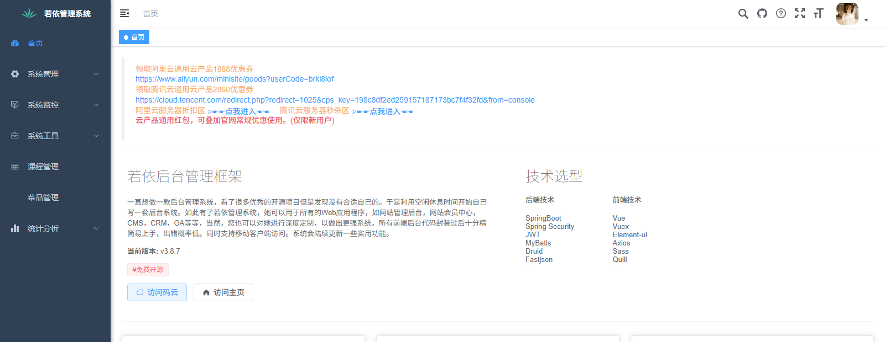

# 苍穹外卖课程项目（RuoYi 前端）

基于 RuoYi-Vue 3.8.7 的苍穹外卖课程项目前端初始化版本，包含登录、权限菜单、系统管理和基础页面布局。

## 系统界面

后台首页展示系统菜单、技术选型和欢迎信息，可作为 RuoYi 模板初始化版本的实际运行效果。

## 系统架构

前端采用 Vue 3 + Vite，路由和状态由 Vue Router / Pinia 管理，Axios 统一封装后端 REST API。

## 项目概览

| 项目信息 | 内容 |
| --- | --- |
| 前端框架 | Vue 3 + Vite |
| UI 组件 | Element Plus |
| 权限体系 | RuoYi 菜单与角色权限 |
| 默认入口 | 登录页 → 后台首页 |
| 后端仓库 | RuoYi-vue-sky-take-out-server |

## 功能范围

- 登录、验证码、权限菜单
- 用户、角色、菜单、部门管理
- 字典、参数、通知公告
- 系统监控与日志页面
- 基于 Vue 3 + Element Plus 的后台布局

## 技术栈

- Vue 3、Vite
- Element Plus、Vue Router、Pinia
- Axios、ECharts
- RuoYi-Vue 3.8.7

## 环境要求

- Node.js 18+
- npm 或 pnpm

## 安装与启动

~~~bash
git clone https://github.com/Smasun0721/RuoYi-vue-sky-take-out-client.git
cd RuoYi-vue-sky-take-out-client
npm install
npm run dev
~~~

后端地址通过 VITE_APP_BASE_API=/dev-api 代理，具体配置见 .env.development 和 vite.config.js。

## 目录结构

~~~text
RuoYi-vue-sky-take-out-client/
├── src/
│   ├── api/
│   ├── assets/
│   ├── components/
│   ├── layout/
│   ├── router/
│   ├── store/
│   └── views/
├── public/
├── vite/
├── package.json
├── pnpm-lock.yaml
└── vite.config.js
~~~

## 关联仓库

- 服务端：[RuoYi-vue-sky-take-out-server](https://github.com/Smasun0721/RuoYi-vue-sky-take-out-server)

## 说明

本项目是课程项目的初始化版本，保留 RuoYi-Vue 原始结构和基础页面；外卖业务页面在此基础上继续开发。默认登录账号和密码由后端数据库初始化脚本提供，请以实际部署配置为准。
